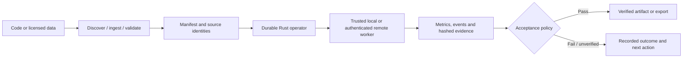

# NeVeRhOOd AEGIS DATA Frameworks

**Build, test, evaluate, and recover software and AI workflows with verifiable evidence.**

A practical, open-source developer platform from **NeVeRhOOd Academy**, maintained by **Henry Barton** ([@tooljhlb](https://github.com/tooljhlb)). Built around a Rust-native CLI and operator, with a local API, developer workspace, and optional research adapters.

[View verification workflow](https://github.com/tooljhlb/NeVeRhOOd-aegis-DATA-Framworks/actions/workflows/ci.yml)
[](LICENSE)
[](crates/aegis-data)

> **This is a working developer/data/evaluation application—not a model checkpoint, a cloud notebook bundle, or a promise of a fully automated frontier trainer.** Run it locally, integrate it with your own tools, and extend it using explicit adapter contracts.

## What you can do

| System | Current capabilities |
| --- | --- |
| **Prepare data** | Import license/revision-aware JSONL; preserve code bytes; deterministic group splits; Protobuf samples; immutable shard manifests and validation |
| **Evaluate** | Classification and regression scoring, baseline/candidate comparison, artifact-derived gates, structured acceptance reports |
| **Run recoverable jobs** | Durable SQLite operator, stage dependencies, retries, leases, fencing, cancellation, verified execution receipts and exports |
| **Automate software projects** | Project discovery, polyglot source inventory, toolchain checks, bounded commands, protected-change rehearsal and rollback |
| **Operate locally or remotely** | Authenticated loopback API, operator cockpit, local workspace, isolated container profiles and authenticated remote worker transport |
| **Investigate runs** | Logs, event history, dependency graph, tamper-evident hashes, artifact identity, source-impact analysis and outcome statistics |
| **Experiment with models** | An optional reference trainer, model-adapter contracts and held-out evaluation tooling; larger model runtimes are external integrations |

Aegis DATA Frameworks works for ordinary software repositories **and** AI development. You do not need to run a particular model or supply a hosted-model API key to use the native backend.

## Quick start

### Requirements

- Stable Rust toolchain and Cargo.
- A C++17 compiler and CMake 3.24+ for the complete native verification suite.
- Linux x86_64 is the currently verified installation target. Other hosts may require adaptation.
- Python/PyTorch only for the **optional** research trainer; Node only for the optional Monaco editor build.

```bash
git clone https://github.com/tooljhlb/NeVeRhOOd-aegis-DATA-Framworks.git
cd NeVeRhOOd-aegis-DATA-Framworks

# Build and test the native application
cargo test --workspace --locked

# Inspect the capabilities and use-case catalogue
cargo run --locked -- capabilities
cargo run --locked -- use-cases

# Prepare + validate the included sample data
cargo run --locked -- prepare examples/text.jsonl /tmp/aegis-public-dataset
cargo run --locked -- validate-dataset /tmp/aegis-public-dataset

# Evaluate examples
cargo run --locked -- classify examples/classification.json
cargo run --locked -- regression examples/regression.json
```

Use a fresh dataset/output path each time. Sample results verify the toolchain's operation; they are not claims about any real model's capability.

### Discover your own project

```bash
cargo run --locked -- project-discover /path/to/your-project /tmp/aegis-discovery --run-id example-discovery-1
```

Review the generated report, execution plan and runtime profile before running commands. Discovery does **not** install dependencies or launch project commands.

### Execute a reference workflow

```bash
python3 -m pip install -e './research[eval]'
cargo run --locked -- operator-reference /tmp/aegis-public-operator.db fixtures/reference-code \
  --out /tmp/aegis-public-reference --run-id public-reference-1 \
  --steps 4 --python python3 --trusted-local
cargo run --locked -- operator-status /tmp/aegis-public-operator.db public-reference-1
```

The reference workflow runs actual preparation, validation, small training, held-out evaluation, comparison, acceptance gating and export. `--trusted-local` executes commands on your machine: use it only for projects you trust. More isolated execution requires reviewed digest-pinned OCI images.

### Inspect the graph fabric

```bash
cargo run --locked -- graph-import-catalog /tmp/aegis-public-operator.db
cargo run --locked -- graph-snapshot /tmp/aegis-public-operator.db --out /tmp/aegis-public-graph.json
cargo run --locked -- graph-verify /tmp/aegis-public-operator.db
```

The bundled graph catalog is a small **public example**. A declared graph does not imply a running machine-learning graph or implemented teacher.

## Architecture



- **Core:** Rust/Tokio, SQLite, Protobuf, authenticated API.
- **Native reference:** C++17 with optional CUDA primitives (complete GPU training is not implemented).
- **Optional research:** Python/PyTorch mathematical reference and small CPU experiments.
- **Developer interface:** local operator cockpit and editor workspace; optional Monaco + language-server frontend.
- **Interoperability:** JSON at control boundaries, versioned Protobuf messages and optional FlatBuffers schemas.

## Developer guides

[Installation](docs/INSTALL.md) · [Capabilities](docs/CAPABILITIES.md) · [Operator / UI](docs/OPERATOR.md) · [Project workflow](docs/PRODUCT_LOOP.md) · [Architecture](docs/ARCHITECTURE.md) · [Remote workers](docs/REMOTE.md) · [Acceptance](docs/ACCEPTANCE.md) · [Graph fabric](docs/GRAPH_FABRIC.md) · [Artifact transport](docs/ARTIFACTS.md) · [Model adapters](docs/AI_BACKEND.md) · [Roadmap](docs/ROADMAP.md).

## Evidence and limitations

This public edition starts with **independent release history and evidence-neutral acceptance entries**. It does not inherit private test receipts or internal deployment metadata. The public verification workflow is included, but this initial public release has not yet obtained a successful native CI result. GitHub's first attempts ended before executing test steps. Run `bash scripts/verify.sh` on a supported Linux machine for revision-specific native verification. Unexecuted or missing proofs remain unverified; successful unit tests do not certify end-to-end model quality, independent field deployments, complete GPU training, or a fully autonomous IDE.

See [acceptance coverage](docs/READINESS.md) and [security guidance](SECURITY.md). No customer secrets, external accounts, datasets, private checkpoints, or compute-provider setups are included.

## Community and support

Contributions, documentation fixes, portable integrations, benchmark adapters and reproducible bug reports are welcome. Read [CONTRIBUTING.md](CONTRIBUTING.md) before opening a PR, or use [GitHub Issues](https://github.com/tooljhlb/NeVeRhOOd-aegis-DATA-Framworks/issues) to discuss an improvement.

**Support development:** A GitHub Sponsors configuration is included at [`.github/FUNDING.yml`](.github/FUNDING.yml). Sponsorship availability depends on the maintainer activating a GitHub Sponsors profile and repository funding features.

MIT licensed; see [LICENSE](LICENSE). Third-party editor notices remain under [subsystems/editor/licenses](subsystems/editor/licenses).

**Project:** NeVeRhOOd Academy · **Framework:** AEGIS DATA Frameworks · **Maintainer:** Henry Barton.
